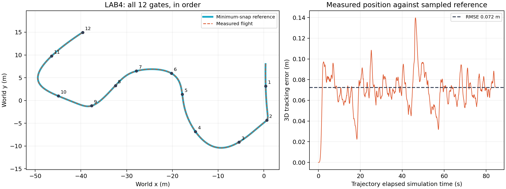

# MIT VNAV LAB4：轨迹优化与无人机竞速

已在 E 盘 Ubuntu 虚拟机完成代码、编译、定点测试与完整赛道验证。工作空间：`/home/han/lab4_ws`；仿真器：`/home/han/vnav-builds/lab4/lab4.x86_64`。

## 验证结果

- 最终采用 race03：12/12 道门按序到达；规划时长 84.468 秒，进入第 12 门中心 0.65 米范围的时刻为 81.200 秒。计时使用仿真时间。
- 位置跟踪 RMSE 0.0723 米，最大误差 0.1397 米。
- 起飞阶段有 91 条地板接触消息（同一次接触可产生多条消息），没有撞门记录；原始事件见 validation/race03/race_result.json。
- 独立离线读取 rosbag：前 11 门真实轨迹按序穿越门平面，终点实测位置误差 0.0562 米；末端参考速度为零。终点为悬停目标，不额外要求飞出最后一道门。
- 14 个相关 ROS 包编译通过，见 validation/catkin_build.log。Part 0 第一门悬停通过，见 validation/static/result.json。
- 第一轮 race01 也到达 12 门，规划 112.129 秒、RMSE 0.0647 米；启动阶段曾落地。race02 因 ROS master 重启竞态未完成。交付记录选择已完整验证的较快 race03。

## 文件

- `theory/LAB4_individual.pdf`：Deliverable 1–2，全套推导与结果，3 页。
- `src/planner_pkg`：Part 0；`src/trajectory_generation_pkg`：Part 1.1–1.3。
- `src/controller_pkg`：LAB3 控制器；两个 LAB4 launch 使用相同调参值。
- `src/dependencies`：随课程代码提供的依赖；系统库适配已包含。
- `src/tesse_ros_bridge`：LAB4 使用的桥接源码，修复重复/回退时间戳导致 UDP 接收线程退出的问题。
- `media/drone_race.mp4`：完整比赛视频；`validation/race03/race.bag`：原始 ROS 数据。
- `validation/race03/*validation.json`、`race_result.json`、CSV 与 `images/flight_validation.png`：可复核证据。
- `scripts`：启动、录制、监测和 rosbag 独立验证脚本；针对当前虚拟机绝对路径配置。

## 在当前虚拟机运行

```bash
source ~/lab4_ws/devel/setup.bash
# 三个终端依次启动；运行前结束上一轮 planner/controller，保持单个仿真器和桥接实例。
bash ~/lab4_results/start_sim.sh
bash ~/lab4_results/start_bridge.sh
bash ~/lab4_results/run_race.sh my_run 3 2 1.3
```

普通手动启动方式：先启动仿真器、桥接，再 `roslaunch trajectory_generation traj_following.launch`，最后 `roslaunch planner_pkg traj_gen.launch`。`roslaunch planner_pkg static_point_test.launch` 用于第一门悬停，不能与轨迹跟随同时运行。

查看 rosbag：`rosbag info validation/race03/race.bag`。包含 `/current_state`、`/desired_state`、`/desired_traj_vertices`、`/clock`、`/tesse/collision`、`/tf`。离线检查：`python3 scripts/verify_bag.py validation/race03`（先 source ROS 工作空间）。

## 从源码重编译

在已安装 ROS Noetic、catkin_tools、TESSE Python 接口的 Ubuntu 20.04 环境，将 `src` 放到新工作空间，例如 `~/lab4_repro_ws/src`。系统依赖包括 `libgoogle-glog-dev libnlopt-cxx-dev libyaml-cpp-dev libeigen3-dev` 及各 package.xml 声明的 ROS 包。

```bash
source /opt/ros/noetic/setup.bash
cd ~/lab4_repro_ws
catkin init
catkin config --extend /opt/ros/noetic --cmake-args -DCMAKE_BUILD_TYPE=Release -DCATKIN_ENABLE_TESTING=ON
catkin build planner_pkg trajectory_generation controller_pkg tesse_ros_bridge --no-status -j2 -p2
source devel/setup.bash
```

glog_catkin、yaml_cpp_catkin、nlopt 使用系统库，避免旧版下载地址失效；原始 CMakeLists 保存在各包 CMakeLists.upstream.txt。eigen_checks 的上游构建依赖测试框架，因此保留 CATKIN_ENABLE_TESTING=ON。

控制参数：kx=1，kv=2，kr=4，komega=1，kx_z=4，kv_z=4。轨迹参数：v_max=3，a_max=2，time_scale=1.3；这是段时间估算参数，**不表示严格的速度/加速度上界**。位置、yaw 采用相同段时长，yaw 连续展开，结束后保持终点。VMware 已开启 3D 加速，实际 Unity 约 59 FPS。

## 提交前尚需完成

`rviz_drone_race.txt` 已填写本仓库视频和 rosbag 的 GitHub 公开下载地址。课程原文指定 Google Drive/Dropbox；如严格按课程渠道提交，仍需上传到对应云盘并替换链接。仓库整理不等于课程系统已接收作业。个人 PDF 需自行补充姓名、学号并确认理解。

- [三页个人题解](theory/LAB4_individual.pdf)
- [完整比赛视频](media/drone_race.mp4)（[直接下载](https://raw.githubusercontent.com/LittleHorseyaya/vnav/main/lab4/media/drone_race.mp4)）
- [完整 rosbag](validation/race03/race.bag)（[直接下载](https://raw.githubusercontent.com/LittleHorseyaya/vnav/main/lab4/validation/race03/race.bag)）
- [独立离线核验](validation/race03/offline_validation.json)



要求来源：https://vnav.mit.edu/labs_2023/lab4/exercises.html
代码版本入口：https://github.com/MIT-SPARK/VNAV-labs/releases/tag/VNAV2021
